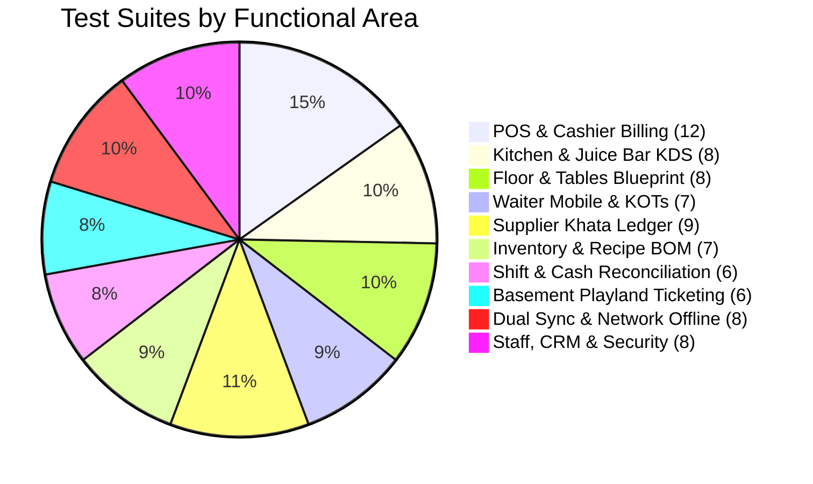

# 👑 SULTAN RESTAURANT & BASEMENT PLAYLAND
## Master Software Quality Assurance (QA) & Test Case Specification

> **Document Version:** 2.1.0  
> **Target Scope:** 100% System Coverage (Front-of-House, Kitchen KDS, Cashier POS, Playland, Inventory BOM, Supplier Ledger, Shift Cashier, Real-time Sync)  
> **Execution Types:** Manual Acceptance, Automated Unit, Integration, Edge-Case & Stress Resilience  
> **Pass Criteria:** Zero Data Loss, Strict RBAC Enforcement, 100% Khata & Shift Drawer Mathematical Accuracy

---

## Test Execution Summary Dashboard



---

## SUITE 1: Floor Plan & Table Management (`/admin/tables`, `/manager/floor-plan`)

| Test Case ID | Test Scenario | Preconditions | Step-by-Step Procedure | Expected Result | Priority |
| :--- | :--- | :--- | :--- | :--- | :--- |
| **TC-TBL-001** | Table Seating & Status Transition | Table T-04 is Green (Available) | 1. Tap Table T-04.<br>2. Select "Occupy Table" and assign 4 guests.<br>3. Confirm. | Table color changes to Red (Occupied). Active timer starts. Table appears occupied on all connected waiter tablets. | **P0 (Critical)** |
| **TC-TBL-002** | Table Transfer Across Floors | Table T-02 (Ground) has open KOTs worth Rs. 6,500 | 1. Tap Table T-02 -> Select "Transfer Table".<br>2. Select Destination Table R-05 (Rooftop).<br>3. Confirm transfer. | All active KOTs, items, and running bill move to R-05. T-02 becomes Purple (Dirty/Cleaning). | **P0 (Critical)** |
| **TC-TBL-003** | Table Merge (Joint Bill) | Tables T-06 and T-07 are adjacent with separate guests | 1. Select Table T-06.<br>2. Tap "Merge Table" -> Choose T-07.<br>3. Confirm joint billing. | Tables visually link. A single consolidated bill is maintained for cashier settlement. | **P1 (High)** |
| **TC-TBL-004** | Advance Table Reservation | Table T-10 is Available | 1. Tap Table T-10 -> "Reserve".<br>2. Input Guest Name: "Dr. Tariq", Phone, Guest Count: 8, Time: 09:00 PM.<br>3. Save reservation. | Table becomes Amber (Reserved). 30 minutes before 9:00 PM, an urgent reservation reminder chime plays. | **P1 (High)** |
| **TC-TBL-005** | Table Bill Print Request | Table T-01 is Occupied | 1. Waiter taps "Request Bill" on mobile tablet. | Table status updates to Blue (Billed). Cashier POS terminal highlights table with a blinking billing badge. | **P0 (Critical)** |
| **TC-TBL-006** | Housekeeping Cleaning Turnaround | Table T-01 bill settled | 1. After settlement, table enters Dirty (Purple) status.<br>2. Housekeeping staff taps "Mark Cleaned". | Table transitions to Green (Available) and is unlocked for new guest seating. | **P2 (Medium)** |

---

## SUITE 2: Waiter Digital Order-Taking (`/waiter`, `/waiter/order/[tableId]`)

| Test Case ID | Test Scenario | Preconditions | Step-by-Step Procedure | Expected Result | Priority |
| :--- | :--- | :--- | :--- | :--- | :--- |
| **TC-WTR-001** | Multi-Item Order Firing | Waiter logged into Table G-03 | 1. Select 1x Mutton Karahi Full.<br>2. Select 4x Roghni Naan.<br>3. Select 2x Fresh Lime Soda.<br>4. Tap "Fire KOT to Kitchen". | Order fires instantly. KOT number is assigned. Waiter sees "Sent to Kitchen" confirmation alert. | **P0 (Critical)** |
| **TC-WTR-002** | Custom Dish Modifiers & Instructions | Waiter selecting Chicken Handi | 1. Select Chicken Handi.<br>2. In notes field, type: "Less spice, extra ginger on top".<br>3. Fire order. | Notes display prominently in bold yellow highlight on Kitchen KDS ticket. | **P1 (High)** |
| **TC-WTR-003** | Multi-Round (Staged) Dining | Table has finished starters | 1. Open Table G-03.<br>2. Select "Round 2 - Main Course".<br>3. Add Chicken Malai Boti and Kabab Platter.<br>4. Fire Round 2. | Kitchen KDS clearly tags ticket as "ROUND 2". Bill accumulator appends new items without overwriting Round 1. | **P1 (High)** |
| **TC-WTR-004** | Chef 86 Out-of-Stock Prevention | Chef marked "Fish Tikka" Out of Stock | 1. Waiter attempts to add Fish Tikka to cart. | Item is disabled with a red "86 - Out of Stock" badge. Waiter is blocked from firing the order. | **P0 (Critical)** |
| **TC-WTR-005** | Offline Wi-Fi Drop During Order Firing | Wi-Fi router power unplugged | 1. Waiter fires order while tablet shows "Offline".<br>2. Reconnect Wi-Fi. | Order is held in local SQLite/AsyncStorage queue. Upon reconnection, order automatically syncs without user intervention. | **P0 (Critical)** |

---

## SUITE 3: Kitchen & Juice Bar KDS (`/kitchen/kds`, `/juicebar/kds`)

| Test Case ID | Test Scenario | Preconditions | Step-by-Step Procedure | Expected Result | Priority |
| :--- | :--- | :--- | :--- | :--- | :--- |
| **TC-KDS-001** | Automated Category Ticket Splitting | Order contains 1x Karahi, 2x Naan, 2x Mango Shake, 1x Falooda | 1. Waiter fires order. | - **Kitchen KDS:** Displays Karahi & Naan.<br>- **Juice Bar KDS:** Displays Mango Shake & Falooda.<br>Both screens receive tickets simultaneously. | **P0 (Critical)** |
| **TC-KDS-002** | Preparation Urgency Color Shifts | Order received 0 minutes ago | 1. Observe ticket at 0-9 mins.<br>2. Observe ticket at 10-19 mins.<br>3. Observe ticket at 20+ mins. | - **0-9 mins:** Green border (Normal).<br>- **10-19 mins:** Amber border (Urgent).<br>- **20+ mins:** Red flashing border with repeating alert sound. | **P1 (High)** |
| **TC-KDS-003** | Bump Bar Order Clearing | Dish prepared and ready on hotplate | 1. Chef taps "BUMP" or touches ticket on touchscreen. | Ticket clears from active line. Notification sent to Floor Captain: "Table G-03 Karahi Ready for Pickup". | **P0 (Critical)** |
| **TC-KDS-004** | Recall Bumped Ticket (Undo) | Chef accidentally bumped ticket | 1. Chef taps "Recent Bumped Orders" tab.<br>2. Taps "Recall Ticket". | Ticket immediately reappears on active KDS screen with original elapsed timer intact. | **P2 (Medium)** |

---

## SUITE 4: Cashier Point of Sale (POS) & Invoicing (`/admin/pos`)

| Test Case ID | Test Scenario | Preconditions | Step-by-Step Procedure | Expected Result | Priority |
| :--- | :--- | :--- | :--- | :--- | :--- |
| **TC-POS-001** | Exact Cash Payment Settlement | Bill Total is Rs. 4,850 | 1. Cashier enters Cash Tendered: Rs. 5,000.<br>2. Taps "Settle & Print". | Change due displays as Rs. 150. Cash drawer automatically triggers open. Thermal receipt prints in 80mm format. | **P0 (Critical)** |
| **TC-POS-002** | Split Tender (Cash + Card) | Bill Total is Rs. 10,000 | 1. Select "Split Payment".<br>2. Enter Cash: Rs. 4,000.<br>3. Enter Card: Rs. 6,000 with Card Approval Code.<br>4. Settle. | Invoice records dual tender types. Both tenders reflect correctly in shift cash reconciliation. | **P0 (Critical)** |
| **TC-POS-003** | Manager Discount Override PIN | Subtotal is Rs. 8,000 | 1. Cashier attempts 20% VIP discount.<br>2. System prompts for Manager PIN.<br>3. Enter valid Manager PIN. | Discount applies (Rs. 1,600). Audit log records Manager ID who authorized the discount. | **P1 (High)** |
| **TC-POS-004** | Invalid Discount PIN Rejection | Subtotal is Rs. 8,000 | 1. Cashier enters incorrect PIN "0000". | Discount rejected with "Unauthorized Manager PIN" error alert. | **P1 (High)** |
| **TC-POS-005** | WhatsApp Digital Invoice & QR Code | Invoice completed | 1. Customer provides phone number 03001234567.<br>2. Cashier taps "WhatsApp Invoice". | WhatsApp Web / API opens pre-filled with formatted invoice breakdown and feedback link. | **P1 (High)** |
| **TC-POS-006** | Credit Customer Khata Billing | Registered corporate guest dining | 1. Select "Customer Khata (Credit)".<br>2. Choose "Packages Ltd Corporate A/C".<br>3. Confirm settlement. | Invoice closes with 0 cash received. Rs. 8,000 debited to Packages Ltd corporate ledger. | **P0 (Critical)** |

---

## SUITE 5: Basement Amusement Playland Ticketing (`/admin/playland`)

| Test Case ID | Test Scenario | Preconditions | Step-by-Step Procedure | Expected Result | Priority |
| :--- | :--- | :--- | :--- | :--- | :--- |
| **TC-PLY-001** | Single Ride Token Issuance | Customer purchases 2x Carousel tokens | 1. Tap "Royal Carousel" (Rs. 200 x 2 = Rs. 400).<br>2. Settle Cash.<br>3. Print. | Two thermal barcode tokens print. Each token has unique QR code valid for exactly 1 ride entry. | **P0 (Critical)** |
| **TC-PLY-002** | All-Day Unlimited Wristband Pass | Customer buys 1x Unlimited Pass (Rs. 1,200) | 1. Select "All-Day Unlimited Wristband".<br>2. Settle payment.<br>3. Print wristband barcode. | Wristband is fastened. System allows unlimited punches across all 6 rides for the current date. | **P0 (Critical)** |
| **TC-PLY-003** | Ride Gate Puncher Verification | Single Carousel token scanned | 1. Gate attendant scans token at Carousel scanner. | Screen flashes GREEN: "Access Granted - 1 Rider". Token status updates to "USED". | **P0 (Critical)** |
| **TC-PLY-004** | Re-scan of Used Single Token (Fraud Prevention) | Same token scanned a second time | 1. Attendant scans already-used token. | Screen flashes RED with buzzer sound: "Access Denied - Token Already Used at 04:15 PM". | **P0 (Critical)** |
| **TC-PLY-005** | Playland Daily Shift Margin Audit | End of Day | 1. Open Playland reports tab. | Displays exact count of riders per jhoola, revenue breakdown, and maintenance float. | **P1 (High)** |

---

## SUITE 6: Recipe BOM & Automated Inventory Burn (`/admin/recipes`, `/admin/inventory`)

| Test Case ID | Test Scenario | Preconditions | Step-by-Step Procedure | Expected Result | Priority |
| :--- | :--- | :--- | :--- | :--- | :--- |
| **TC-BOM-001** | Accurate Proportional Inventory Burn | Recipe: 1kg Chicken Karahi requires 1000g Chicken, 250g Tomatoes, 50g Ghee | 1. POS settles 3x Chicken Karahi bills.<br>2. Check inventory ledger. | Inventory reduced by:<br>- 3,000g Chicken<br>- 750g Tomatoes<br>- 150g Ghee. | **P0 (Critical)** |
| **TC-BOM-002** | Variant Recipe BOM (Half vs Full) | Recipe has 0.5kg (Half) and 1kg (Full) | 1. POS settles 1x Half Karahi (500g meat) and 1x Full Karahi (1000g meat). | Total 1,500g meat deducted from cold storage inventory. | **P0 (Critical)** |
| **TC-BOM-003** | Low-Stock Push Notification | Tomatoes stock drops below 5kg threshold | 1. Inventory auto-burn brings stock to 4.2kg. | System triggers banner alert and low-stock badge on manager dashboard. | **P1 (High)** |
| **TC-BOM-004** | Manual Stock Take Reconciliation | Physical count shows 45kg Chicken, system shows 48kg | 1. Manager opens Stock Adjustment.<br>2. Enters Physical: 45kg.<br>3. Reason: "Kitchen trim & fat loss".<br>4. Save. | Inventory balance updates to 45kg. Discrepancy logged as operational shrinkage expense. | **P1 (High)** |

---

## SUITE 7: Supplier Khata Ledger & Procurement (`/admin/supplier-ledger`)

| Test Case ID | Test Scenario | Preconditions | Step-by-Step Procedure | Expected Result | Priority |
| :--- | :--- | :--- | :--- | :--- | :--- |
| **TC-LED-001** | Purchase Bill Goods Inward Entry | Raw meat delivered by "Al-Madina Fresh Poultry" | 1. Click "+ New Purchase Bill".<br>2. Select Al-Madina Poultry.<br>3. Add 100kg Boneless Chicken @ Rs. 650/kg = Rs. 65,000.<br>4. Add Carriage Rs. 1,000.<br>5. Enter Cash Paid: Rs. 15,000.<br>6. Save Bill. | Total Bill = Rs. 66,000.<br>Khata balance increases by net Rs. 51,000.<br>Inventory increases by 100kg. | **P0 (Critical)** |
| **TC-LED-002** | Vendor Payment Voucher Settlement | Vendor current balance is Rs. 51,000 | 1. Click "Record Payment".<br>2. Select Al-Madina Poultry.<br>3. Enter Amount: Rs. 30,000.<br>4. Method: Online Bank Transfer (Meezan Bank, Ref: TXN-99882).<br>5. Confirm. | Balance drops to Rs. 21,000.<br>Official 80mm Payment Voucher VCH-XXXXXX generated.<br>Auto-logged to daily expenses. | **P0 (Critical)** |
| **TC-LED-003** | Chronological Running Balance Math | Multiple bills and payments over 1 month | 1. Open Complete Khata Ledger tab for vendor.<br>2. Audit row-by-row math. | Every row satisfies: `New Balance = Previous Balance + Debit - Credit`. No NaN or rounding errors. | **P0 (Critical)** |
| **TC-LED-004** | Payment Reversal / Void | Accidental payment of Rs. 10,000 entered | 1. Click trash icon on voucher.<br>2. Confirm "Revert Payment". | Voucher removed.<br>Vendor balance increases back by Rs. 10,000.<br>Expense entry reversed. | **P1 (High)** |
| **TC-LED-005** | WhatsApp Vendor Statement Generation | Vendor requests account statement | 1. Click WhatsApp share icon. | Formatted Urdu/English text generated with opening balance, all recent bills, payments, and net payable. | **P1 (High)** |

---

## SUITE 8: Shift Management & Cash Drawer Reconciliation (`/admin/shift`)

| Test Case ID | Test Scenario | Preconditions | Step-by-Step Procedure | Expected Result | Priority |
| :--- | :--- | :--- | :--- | :--- | :--- |
| **TC-SFT-001** | Morning Shift Opening Float | Shift starts at 11:00 AM | 1. Manager enters Opening Cash Float: Rs. 20,000.<br>2. Clicks "Open Shift". | Shift timer starts. Cash drawer expected base is set to Rs. 20,000. | **P0 (Critical)** |
| **TC-SFT-002** | Mid-Shift Safe Drop (حفاظتی کیش ڈراپ) | Cash drawer exceeds Rs. 150,000 | 1. Manager performs Safe Drop of Rs. 100,000 to main office locker.<br>2. Enters Manager PIN. | Expected cash in drawer reduces by Rs. 100,000. Safe receipt printed. | **P0 (Critical)** |
| **TC-SFT-003** | End of Day Cash Drawer Balancing | Expected cash in drawer is Rs. 65,000 | 1. Cashier physically counts bills & coins: Rs. 65,000.<br>2. Enters Rs. 65,000.<br>3. Clicks "Close Shift". | Discrepancy displays: Rs. 0 (حساب برابر ہے). Shift report closes with balanced green banner. | **P0 (Critical)** |
| **TC-SFT-004** | Cash Shortage Detection | Expected cash is Rs. 70,000 | 1. Physical count is Rs. 68,500. | Discrepancy displays: -Rs. 1,500 (Shortage). Red alert requires manager reason explanation before closing. | **P0 (Critical)** |
| **TC-SFT-005** | Cash Excess / Surplus Detection | Expected cash is Rs. 50,000 | 1. Physical count is Rs. 50,800. | Discrepancy displays: +Rs. 800 (Surplus). Surplus recorded as miscellaneous cash inflow. | **P1 (High)** |

---

## SUITE 9: Dual-Engine Synchronization & Disaster Recovery

| Test Case ID | Test Scenario | Preconditions | Step-by-Step Procedure | Expected Result | Priority |
| :--- | :--- | :--- | :--- | :--- | :--- |
| **TC-SNC-001** | Zero-Latency LAN Order Sync | Waiter tablet & Kitchen KDS on same Wi-Fi | 1. Waiter fires order on tablet. | Order appears on Kitchen KDS within < 150 milliseconds via WebSocket port 5050. | **P0 (Critical)** |
| **TC-SNC-002** | Internet Blackout Resilience | Broadband fiber cable disconnected | 1. Disconnect ISP internet.<br>2. Fire orders, settle bills, print receipts. | All restaurant operations function 100% smoothly over local LAN hub. No UI freezing or modal blocks. | **P0 (Critical)** |
| **TC-SNC-003** | Cloud Firebase Recovery on Reconnect | 25 bills settled while internet was down | 1. Reconnect ISP internet cable. | System silently background-pushes all 25 settled invoices to Firebase cloud database within 5 seconds. | **P0 (Critical)** |
| **TC-SNC-004** | Server Crash & Auto-Restart | Node.js process killed unexpectedly | 1. Kill `node server.js` process.<br>2. Run `npm run hub` or execute `Start-Sultan-POS.bat`. | Server recovers state from `server-data.json`. All active tables, KOTs, and shifts restore with zero data loss. | **P0 (Critical)** |

---

## SUITE 10: Role-Based Access Control (RBAC) & Security

| Test Case ID | Test Scenario | Preconditions | Step-by-Step Procedure | Expected Result | Priority |
| :--- | :--- | :--- | :--- | :--- | :--- |
| **TC-SEC-001** | Waiter Access Boundary Check | Waiter logged in | 1. Waiter tries to access `/admin/reports` or `/admin/settings`. | Route guard redirects waiter back to `/waiter` with "Access Denied" toast alert. | **P0 (Critical)** |
| **TC-SEC-002** | Cashier Void Restriction | Customer requests bill cancellation | 1. Cashier attempts to void bill. | System requires Manager PIN authorization. Bill cannot be voided by cashier alone. | **P0 (Critical)** |
| **TC-SEC-003** | Session Inactivity Lock | Terminal left unattended for 15 minutes | 1. Leave POS idle. | Screen locks automatically requiring PIN re-entry to prevent unauthorized cashier actions. | **P1 (High)** |

---

## Automated Test Runner Execution Guide

To run the automated test suite on any terminal or deployment machine:

```bash
# 1. Run full programmatic test suite
node scripts/test-suite.js

# 2. Run TypeScript compile check
npx tsc --noEmit

# 3. Run lint verification
npx expo lint
```
