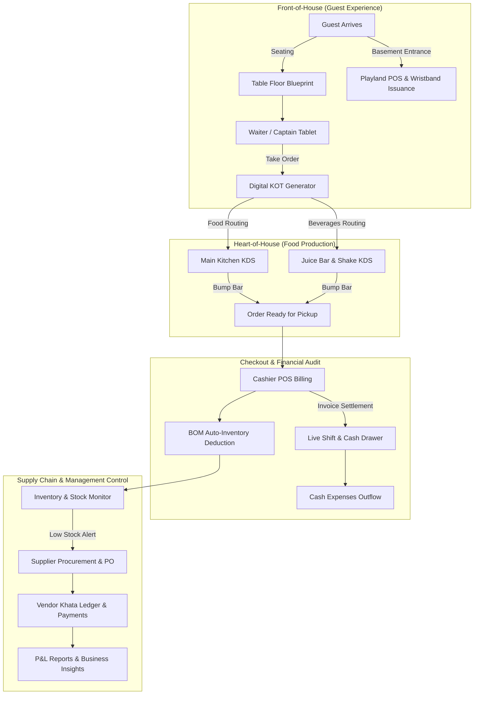
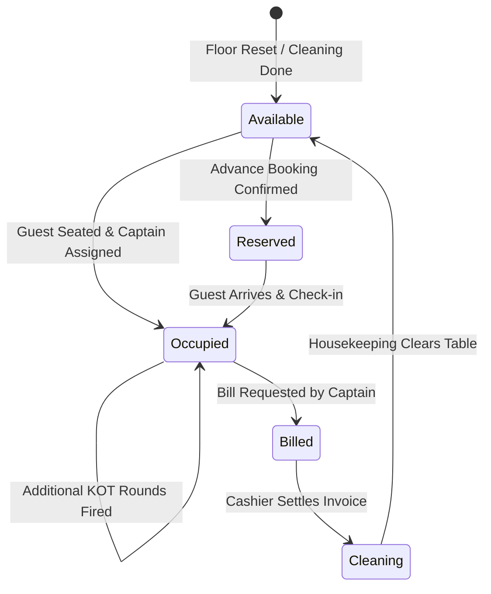
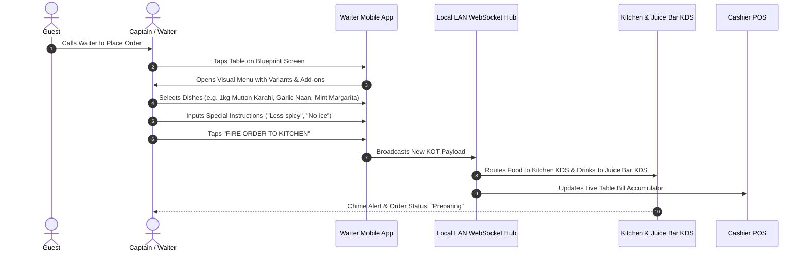
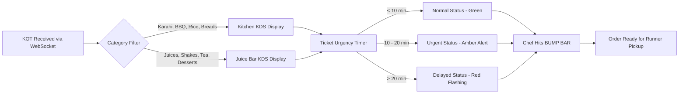
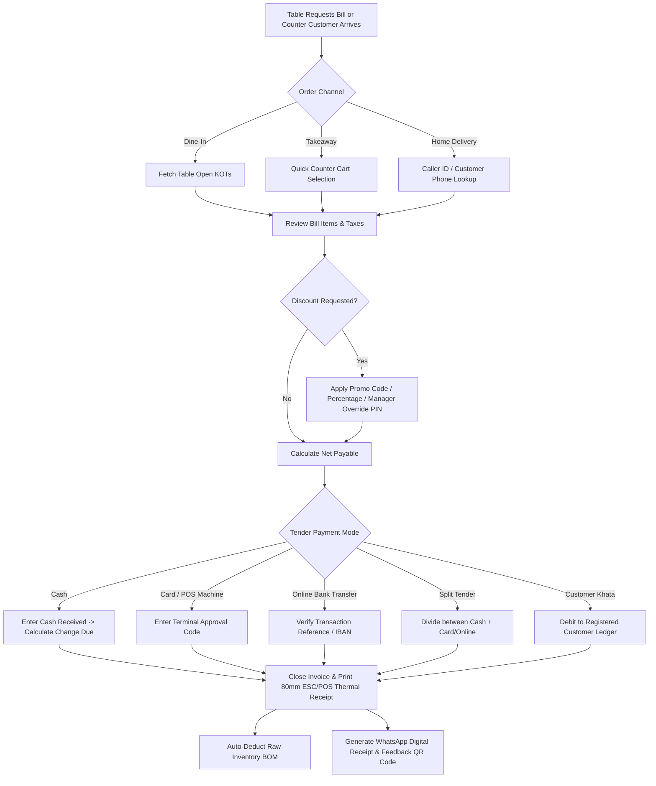
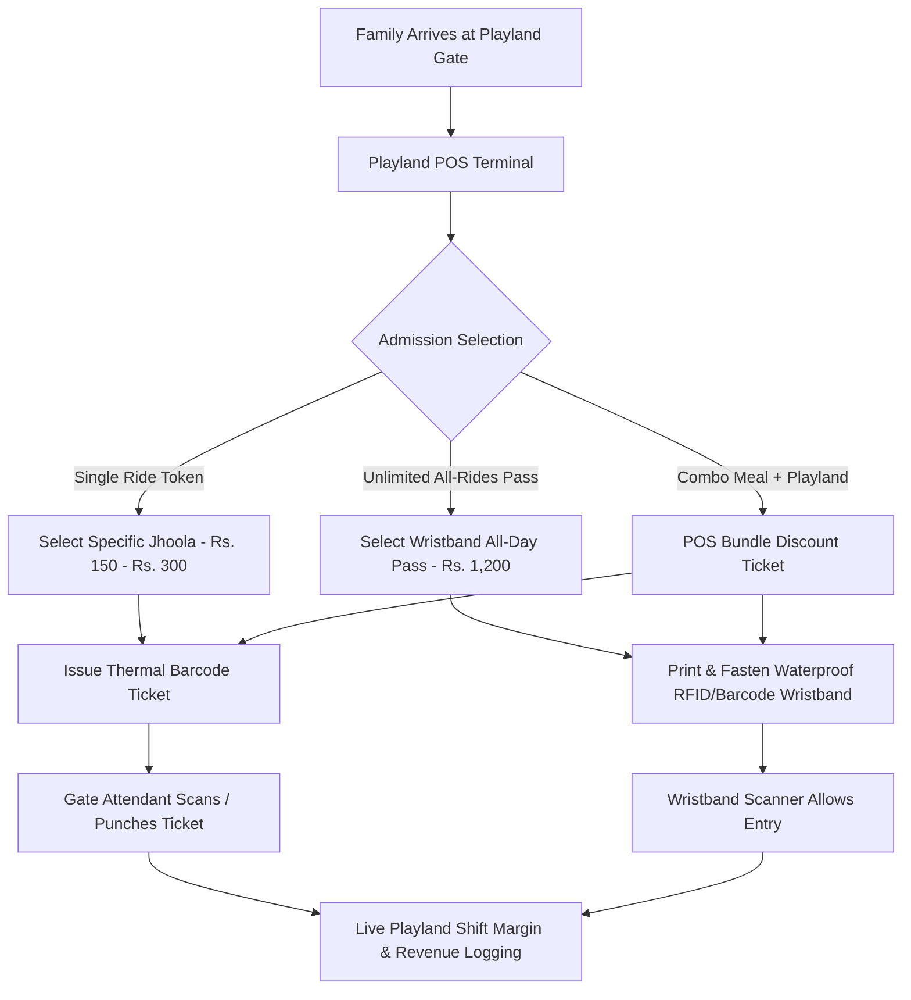
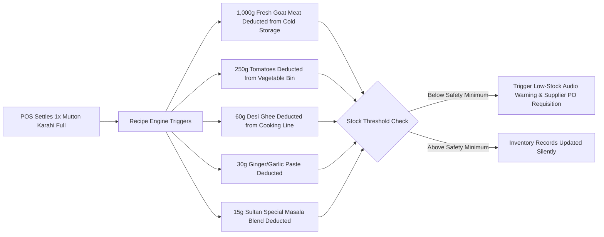
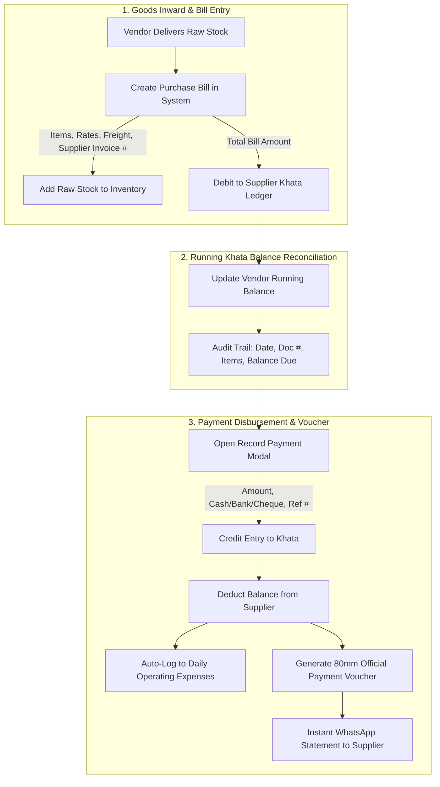
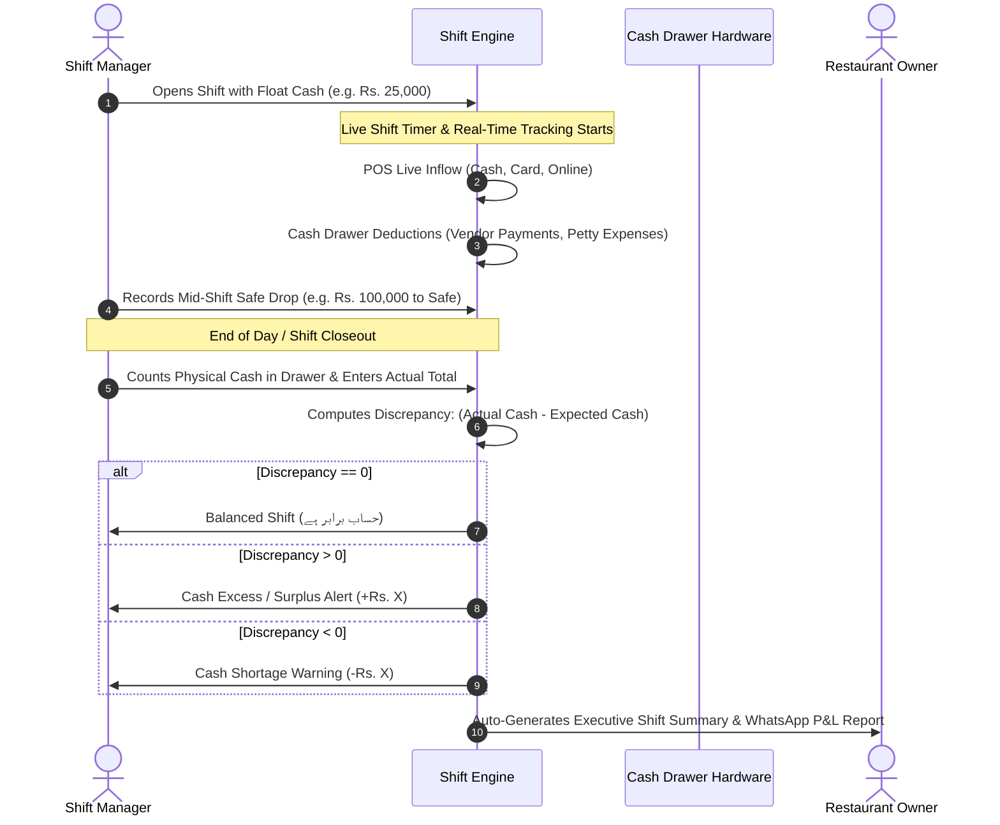
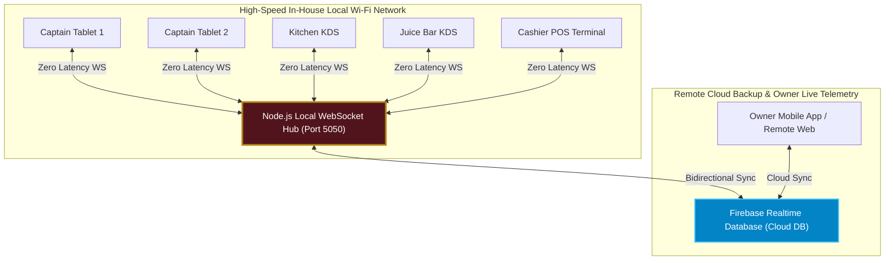

# 👑 SULTAN RESTAURANT & BASEMENT PLAYLAND
## Complete System Workflows, Operations & Architectural Blueprint

> **Document Classification:** Master Operational Manual & Technical Workflow Architecture  
> **Target Audience:** Restaurant Owners, General Managers, Cashiers, Floor Captains, Chefs, IT Administrators  
> **Platform Version:** 2.0.0 (Expo Managed / React Native Web, iOS & Android)  
> **Sync Architecture:** Dual-Engine (Local Wi-Fi LAN WebSocket Port `5050` + Cloud Firebase Realtime Database)

---

## Executive Summary & System Philosophy

**Sultan Restaurant & Basement Playland Management Suite** is an enterprise-grade, offline-capable, cross-platform restaurant operating system. It merges full-service dine-in hospitality, multi-station kitchen display routing, high-throughput cashier POS, amusement ride ticketing, inventory procurement, and double-entry vendor khata ledger into one unified real-time ecosystem.

---

## 1. User Roles & Permission Matrix

The application enforces role-based access control (RBAC) ensuring operational security and privacy:

| Role | Access Level | Primary Working Interfaces | Key Permissions & Constraints |
| :--- | :--- | :--- | :--- |
| **Executive Admin (Owner)** | Full Universal Access | All Admin Routes (`/admin/*`) | Full financial audit, employee salaries, vendor ledger settlements, role delegation, pricing overrides, cloud database resets. |
| **Branch Manager** | Operational Supervisor | Manager Portal (`/manager/*`) | Shift management, opening floats, kitchen handover approvals, voids & returns approvals, petty cash expenses, stock adjustments. |
| **Floor Captain / Waiter** | Order Taker (Mobile) | Waiter Portal (`/waiter/*`) | Visual table occupancy, round order firing, customer seating, bill print requests. *Cannot void bills or see restaurant net margins.* |
| **Head Chef / Kitchen** | Food Production | Kitchen KDS (`/kitchen/kds`), Handover | Order timers, bump bar clearing, ingredient availability (Chef 86), shift raw meat marination handover. |
| **Juice Bar Barista** | Beverage Production | Juice Bar KDS (`/juicebar/kds`) | Drinks, shakes, ice-creams, and dessert tickets expediting. |
| **Cashier / POS Operator** | Billing & Invoicing | POS Terminal (`/admin/pos`, `/manager/pos`) | Invoice generation, split payments (Cash, Card, Online Transfer), discount codes, thermal receipt printing. |
| **Playland Operator** | Amusement Admissions | Playland Hub (`/admin/playland`) | Ride tokens, wristband barcode issuance, single/unlimited passes, amusement ride gate puncher. |

---

## 2. Floor Plan & Table Management Workflow

### Multi-Floor Architecture
The restaurant features a 5-tier floor configuration:
1. **Basement (Playland & Family Dining):** Amusements, family booths, jhoolay queue seating.
2. **Ground Floor (Main Family Dining Hall):** High-traffic central hall, private curtains, large family tables.
3. **1st Floor (Executive Hall):** Banquet seating, corporate dinner setups, sound-isolated cabins.
4. **2nd Floor (Rooftop Open-Air Garden):** Bar B Q live pits, open-sky seating, evening rush tables.
5. **Private VIP Lounges:** Dedicated butler service, reservation-only dining.

### Key Operational Rules:
- **Table Merge (جوائنٹ ٹیبل):** Two adjacent tables can be combined for large parties, unifying their KOT tickets and bills into a single invoice.
- **Table Transfer (ٹیبل منتقلی):** Guests changing floors or seating zones transfer their running bill seamlessly without canceling existing kitchen tickets.
- **Visual Status Color Codes:**
  - 🟢 **Available (Green):** Clean and ready for seating.
  - 🔴 **Occupied (Red):** Dining with active unpaid bill.
  - 🟡 **Reserved (Amber):** Reserved with guest arrival time countdown.
  - 🔵 **Billed (Blue):** Bill printed; waiting for cashier payment.
  - 🟣 **Dirty / Cleaning (Purple):** Awaiting housekeeping turnaround.

---

## 3. Waiter Digital Order-Taking Workflow

### Edge-Case Handling:
- **Offline Resilience:** If Wi-Fi briefly drops, orders queue locally in device storage and auto-fire with retry backoff as soon as reconnection occurs.
- **Multi-Round Orders (راؤنڈ آرڈرز):** Starters, Main Course, and Desserts are tagged by round number (`Round 1`, `Round 2`) so the kitchen delivers food at the proper dining pace.

---

## 4. Kitchen & Juice Bar KDS (Expediting Workflow)

### KDS Capabilities:
- **Audio Chime:** Custom royal chime plays on incoming tickets to alert busy line chefs.
- **Urgency Highlights:** Tickets change colors dynamically as the elapsed preparation time increases.
- **Chef 86 (Out of Stock Switch):** If an ingredient finishes mid-service, the head chef toggles the dish off on the KDS console, instantly disabling it across all waiter tablets and customer QR menus.

---

## 5. Point of Sale (POS) & Billing Workflow

---

## 6. Basement Playland & Amusement Park Workflow

The Sultan Restaurant basement houses an indoor family amusement park with 6 signature rides:
1. **Royal Carousel (گھوڑوں والا جھولا)**
2. **Dragon Mini Roller Coaster**
3. **Bumper Cars Arena (ٹکراؤ گاڑیاں)**
4. **Soft Play Jungle Gym (بچوں کا پلے لینڈ)**
5. **9D VR Virtual Reality Simulator**
6. **Trampoline Bounce Park**

---

## 7. Recipe BOM (Bill of Materials) & Inventory Auto-Burn

Every dish variant in the Sultan Restaurant menu is bound to an exact ingredient formulation (BOM):

---

## 8. Suppliers, Procurement & Double-Entry Khata Ledger

The newly architected **Supplier Ledger & Payments Engine** provides full transparency over procurement and accounts payable:

### Key Ledger Formulas:
$$\text{New Running Balance} = \text{Previous Balance} + \text{Procurement Bill (Debit)} - \text{Payment Voucher (Credit)}$$

---

## 9. Shift Management, Cash Drops & Handover Reconciliation

Every shift operates as an isolated financial audit container:

---

## 10. Kitchen Handover, Wastage & Returns Control

To prevent food leakage, shrinkage, and theft between day and night brigades:
- **Raw Marination Handover (مارینیشن ہینڈ اوور):** Morning chef weighs and records prepared meats (e.g. 50kg Chicken Tikka, 30kg Malai Boti, 25kg Mutton Chops). The incoming evening chef must verify and digitally accept the weights.
- **Sales Returns (سیلز ریٹرنز):** If a customer rejects a dish due to spice level or delay, manager approval PIN is required to void the ticket.
- **Damage Control:** Spoiled, burnt, or dropped food is categorized by root cause and deducted from gross kitchen yield to analyze monthly wastage costs.

---

## 11. Dual-Engine Real-Time Sync Architecture

### High Availability Features:
1. **Zero Internet Dependency:** The restaurant functions 100% locally on local Wi-Fi router. Even if PTCL/StormFiber internet goes down, orders, KDS tickets, and POS billing run without stutter.
2. **Instant Cloud Push:** Whenever the internet is alive, every completed invoice and shift summary syncs to Firebase within milliseconds.
3. **Loop Prevention:** The sync engine uses `isApplyingRemoteUpdate` flags and unique transaction IDs to guarantee zero infinite-broadcast ping-pong loops.

---

## 12. Quick Reference: System Routes & Screen Directory

| URL Route | Screen Component | Function & Role |
| :--- | :--- | :--- |
| `/` | `index.tsx` | Universal Portal Navigator (Direct one-click role jump) |
| `/login` | `login.tsx` | Secure PIN & biometric authentication |
| `/waiter` | `src/app/waiter/index.tsx` | Waiter Table Selection & Active Floor Map |
| `/waiter/order/[tableId]` | `order/[tableId].tsx` | Captain Order Taking, KOT firing & Modifiers |
| `/kitchen/kds` | `src/app/kitchen/kds.tsx` | Main Kitchen KDS Line Production Display |
| `/juicebar/kds` | `src/app/juicebar/kds.tsx` | Juice, Shake & Mocktail Expediting Display |
| `/admin/dashboard` | `dashboard.tsx` | Executive Command Center & Real-time Operations |
| `/admin/pos` | `POSTerminalScreen.tsx` | Point of Sale Counter, Invoicing & Thermal Printing |
| `/admin/suppliers` | `SuppliersScreen.tsx` | Vendor Registry, Categories & Contact Profiles |
| `/admin/supplier-ledger` | `SupplierLedgerScreen.tsx` | **Dedicated Double-Entry Khata, Bills & Payment Vouchers** |
| `/admin/shift` | `ShiftManagementScreen.tsx` | Cash Drawer Reconciliation, Safe Drops & Shifts |
| `/admin/inventory` | `InventoryScreen.tsx` | Raw Stock Levels, Inward/Outward Logs & Thresholds |
| `/admin/menu` | `menu.tsx` | Food Menu Catalog, Category Tree & Pricing |
| `/admin/recipes` | `RecipeManagerScreen.tsx` | Recipe BOM Formulations & Stock Depletion Ratios |
| `/admin/costing` | `CostingScreen.tsx` | Dish Ingredient Costing Engine & Food Cost Margins |
| `/admin/playland` | `playland.tsx` | Basement Amusement Jhoolay Admissions & Passes |
| `/admin/reports` | `reports.tsx` | Comprehensive Financial Audits, Sales & P&L |
| `/admin/customers` | `customers.tsx` | Customer CRM, Delivery Records & Caller ID |
| `/admin/staff` | `staff.tsx` | Employee Attendance, Duty Rosters & Payroll |

---

## Summary of Operations Flow
By connecting every station—from the basement playland gate to the top-floor executive suite—the Sultan Restaurant software provides a fully closed operational loop where:
- Orders never get lost.
- Recipes automatically deplete stock.
- Cash drawers always balance.
- Suppliers' khatas are accurate to the single rupee.
- The owner maintains complete visibility across local and cloud channels.
